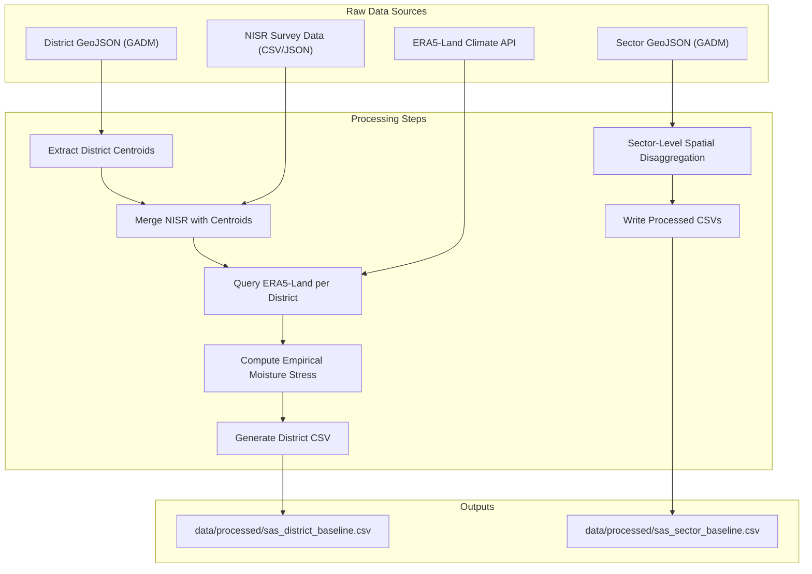

# AgriShield Rwanda – End‑to‑End Project Overview

---

## 1. Problem Statement

Rwanda’s agricultural sector faces significant challenges due to climate variability, limited irrigation infrastructure, and high poverty rates in many districts. Over 845,000 hectares of cropland remain rainfed with less than 5% formal irrigation coverage. Decision‑makers need **granular, district‑ and sector‑level data** that combine:

- **Historical and projected climate variables** (precipitation, temperature, soil moisture).
- **Agricultural land use metrics** (total cropland, irrigated vs. unirrigated areas).
- **Socio‑economic indicators** (poverty percentages from the NISR EICV surveys).

Such integrated data enable evidence‑based planning for climate‑smart agriculture, targeted interventions, and equitable resource allocation.

---

## 2. Solution Overview

The **AgriShield Rwanda** platform compiles a comprehensive dataset and decision engine that merges:

1. **Official NISR survey data** (cropland, irrigation, poverty from SAS and EICV).
2. **Real‑time climate reanalysis** from the ECMWF ERA5‑Land API (2026 season window).
3. **Geospatial centroids & administrative boundaries** derived from GADM Level 2 (Districts) and Level 3 (Sectors).
4. **Sector‑level spatial disaggregation** mapping official NISR district cropland, poverty, and local climate indicators across all 422 administrative sectors.

The result is two high‑quality CSV baselines:
- `sas_district_baseline.csv` – one row per district (30 districts).
- `sas_sector_baseline.csv` – one row per sector (422 sectors).

These files feed into a spatial machine learning pipeline (LightGBM with TreeSHAP explainability) and an interactive 3D geospatial dashboard for Small-Scale Irrigation Technology (SSIT) subsidy targeting.

---

## 3. Architecture Diagram



---

## 4. Datasets Used

| Dataset | Type | Raw Source | Processed Output | Link / Access |
|---|---|---|---|---|
| **District Boundaries (GADM Level 2)** | Vector (GeoJSON) | `data/raw/rwanda_districts_lvl2.json` | 30 District centroids and boundaries | [GADM Rwanda](https://gadm.org/download_country_v3.html) |
| **Sector Boundaries (GADM Level 3)** | Vector (GeoJSON) | `data/raw/rwanda_sectors_lvl3.json` | 422 Sector boundaries | [GADM Rwanda](https://gadm.org/download_country_v3.html) |
| **NISR Official Survey (EICV & SAS baseline)** | Tabular (NISR reports) | Embedded baseline parameters in `fetch_real_climate_and_sas.py` | `data/processed/sas_district_baseline.csv` (30 rows) | [NISR Official Portal](https://www.statistics.gov.rw) |
| **ERA5-Land Climate Reanalysis** | Time-series (API) | Open-Meteo ECMWF ERA5-Land API (Season A 2026) | Integrated into district & sector CSVs | [Open-Meteo Archive API](https://open-meteo.com/en/docs/historical-weather-api) |
| **Sector Baseline Microdata** | Tabular (CSV) | Official NISR survey data mapped across GADM Level 3 sectors | `data/processed/sas_sector_baseline.csv` (422 rows) | Derived within project (`data/processed/`) |

---

## 5. What Information the Dashboard Communicates

The AgriShield Rwanda dashboard translates complex multi-source statistical datasets into actionable policy insights:

1. **Targeting Highest-Vulnerability Areas**: Visualizes which districts and sectors suffer the most acute combination of climate drought risk, rainfed agricultural cropland footprint, and household poverty.
2. **Impact Optimization**: Calculates projected return-on-investment, including:
   - Total hectares of rainfed cropland protected by irrigation interventions.
   - Average poverty incidence reached among targeted beneficiary farming households.
   - Estimated government subsidy capital required ($K \times \$1,200$ per solar pump unit).
3. **Machine Learning Explainability (TreeSHAP)**: Clearly reveals *why* a particular sector or district was prioritized by decomposing predictions into individual feature contributions (soil moisture deficit, dry spell duration, precipitation, and poverty).
4. **Transparent Governance**: Prevents subjective or politically skewed subsidy distribution by providing a reproducible, data-driven multi-criteria optimization ranking.

---

## 6. How Users Can Interact with the Dashboard

Users can explore and test policy scenarios through intuitive interactive controls:

### A. Geospatial 3D Map View
- **Rotate & Pitch**: Hold right-click or drag to explore 3D extruded polygons representing priority scores across Rwanda.
- **Metric Coloring**: Toggle polygon color ramps between *SSIT Allocation Status*, *Priority Score*, *Drought Risk*, *Household Poverty*, and *Rainfed Cropland*.
- **Level Toggle**: Switch between **District view (30 units)** and high-resolution **Sector microdata view (422 units)**.
- **Hover Inspection**: Hover over any district or sector to view real-time climate reanalysis (rainfall, soil moisture, temperature) and EICV poverty stats.

### B. Dynamic Policy Weight Sliders
- Adjust weights in real time:
  - **Climate Moisture Stress ($w_1$)**
  - **Unirrigated Cropland Footprint ($w_2$)**
  - **EICV Household Poverty ($w_3$)**
- The priority score ($w_1 \times \text{Stress} + w_2 \times \text{Cropland} + w_3 \times \text{Poverty}$) instantly recalculates and updates the map and rankings.

### C. Budget Ceiling Slider
- Move the **Available Pump Units slider** ($K$) to expand or contract target subsidy deployments. The algorithm automatically designates the top-$K$ scoring units as *"Identified Targets"*.

### D. Prioritized Deployment Table & Live Search
- **Search Bar**: Type any district or sector name (e.g., *"Bugesera"*, *"Nyagatare"*, *"Cyanika"*) to immediately filter table rows.
- **Status Filter**: Filter by *All Units*, *Allocated*, *Identified Targets*, or *Unallocated*.
- **Manual Overrides**: Click **"+ Allocate Pump"** or **"Deallocate"** on any specific unit to customize allocations, or use **"+ Allocate All Identified"** to bulk-commit targets.
- **Reset**: Click **"Reset Auto-Rank"** to restore original algorithmic prioritization.

### E. One-Click CSV Deployment Export
- Click **"Export Deployment CSV"** to download an official deployment schedule spreadsheet containing unit names, provinces, priority scores, allocation statuses, and recommended subsidy equipment.

---

## 7. End‑to‑End Pipeline Description

1. **Prepare the workspace** – Ensure `data/raw/` and `data/processed/` directories exist (`os.makedirs`).
2. **Load district geometry** – Parse the GADM district GeoJSON and compute the geographic centroid for each district using a recursive point‑extraction algorithm.
3. **Load NISR survey data** – A structured dataset containing `total_cropland_ha`, `irrigated_pct`, and `eicv_poverty_pct` per district.
4. **Merge geometry with survey data** – Create a Pandas DataFrame (`df_nisr`) and calculate `unirrigated_ha`.
5. **Fetch climate variables** – For each district, request ERA5‑Land daily data for the 2026 season, then compute:
   - Total precipitation (mm)
   - Mean temperature (°C)
   - Mean soil moisture (m³ / m³)
   - Number of dry‑spell days (precip < 1 mm)
6. **Calculate empirical moisture stress** – Combine soil‑moisture deficit and dry‑spell intensity using a weighted formula.
7. **Save district baseline** – Write `sas_district_baseline.csv` containing all raw and derived fields.
8. **Disaggregate to sector-level microdata** – Load the sector GeoJSON, iterate over each sector, and:
   - Map official district cropland, poverty, and local climate features across the 422 administrative sectors.
   - Derive sector‑specific cropland area and unirrigated hectares.
   - Compute moisture‑stress index at sector granularity.
9. **Save sector dataset** – Write `sas_sector_baseline.csv` (422 rows).
10. **Downstream Modeling & Serving** – The CSVs are loaded into `model_pipeline.py` (LightGBM Spatial Group K-Fold) and served interactively via the Django web platform (`agrishield_app`).

---

## 8. Setup & Execution

### Prerequisites
- Python 3.10+ (Python 3.11 recommended)
- `pip`

### Run Locally
```bash
# 1. Install dependencies
pip install -r requirements.txt

# 2. Run migrations and collect static files
python manage.py migrate
python manage.py collectstatic --noinput

# 3. Start local development server
python manage.py runserver 8000
```
Open [http://127.0.0.1:8000/](http://127.0.0.1:8000/) in your browser.

---

## 9. References to Core Code

- **Data fetching & processing pipeline** – [`src/fetch_real_climate_and_sas.py`](file:///Users/mac/agrishield-rwanda/src/fetch_real_climate_and_sas.py)
- **Model training & TreeSHAP pipeline** – [`src/model_pipeline.py`](file:///Users/mac/agrishield-rwanda/src/model_pipeline.py)
- **Provenance PDF generator** – [`src/generate_data_provenance_pdf.py`](file:///Users/mac/agrishield-rwanda/src/generate_data_provenance_pdf.py)
- **Web Application Views & Optimization Logic** – [`agrishield_app/views.py`](file:///Users/mac/agrishield-rwanda/agrishield_app/views.py)
- **Interactive Map & Table Controller** – [`agrishield_app/static/agrishield_app/js/app.js`](file:///Users/mac/agrishield-rwanda/agrishield_app/static/agrishield_app/js/app.js)
